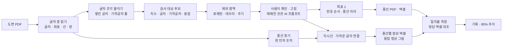

# 검사 기준서 작성 자동화 — 프로젝트 기획서

| 항목 | 내용 |
|---|---|
| 리포 | data10-03 |
| 제출자 | 황수용 |
| 직무·소속 | 품질경영팀 (회사명 생략) |
| 과정 | 현장 데이터 디지털화 전문가과정 2차수 |
| 작성일 | 2026-10-20 |
| 문서 상태 | 초안 v0.1 — 수강생 제출 자료 기반 |

---

## 1. 추진 배경과 현안

- 품질경영팀은 도면을 보고 검사 기준서를 만듭니다. 도면의 검사 대상 표기(치수 · 공차 · 기하공차 · 용접)마다 번호 풍선을 달고, 풍선 번호별로 Spec 과 공차를 엑셀에 옮겨 적는 일입니다.
- 이 일을 자동화하는 프로젝트가 이미 어느 정도 진행되어 있지만, **정확도 · 인식 일치율이 낮아 최소 85% 까지 올리고 싶다**는 것이 제출 원문의 핵심입니다.
- 지금 일치율이 몇 % 인지, 그 숫자를 어떻게 셌는지는 제출 자료에 없습니다(10장 ②). 같은 기준으로 재지 않으면 고쳐도 나아졌는지 알 수 없습니다.
- 도면이 벡터 PDF(CAD 에서 내보낸 것)인지 스캔 그림인지도 아직 모릅니다(10장 ④). 이에 따라 쓸 수 있는 방법이 크게 갈립니다.

## 2. 목표

### 2.1 최종 목표

- **목표 1 · 번호 풍선 자동 배치** — 풍선이 없는 PDF 도면에서 검사 대상 표기를 인식해 그 자리에 번호 풍선을 달고, 풍선이 들어간 PDF 도면을 내보냅니다.
- **목표 2 · 풍선별 정보 엑셀 추출** — 풍선이 이미 있는 PDF 도면에서 풍선마다 가리키는 치수 · 공차 · 용접 정보를 연결해 엑셀로 냅니다. Spec 없이 형상만 있는 용접은 그 형상 그림을 남깁니다.
- **인식 일치율 85% 이상** — 사람이 만든 정답과 대조한 숫자로 확인합니다.

### 2.2 1차 개발 목표

실제 도면과 정답을 받기 전이라, 1차는 **「정답 대조 · 일치율 측정」을 중심에 둔 브라우저 도구**를 만듭니다.

- 벡터 PDF 를 열어 글자(좌표 포함) · 선 · 원을 읽고, 규칙으로 검사 대상 후보를 찾습니다. 사람이 고치고 더할 수 있습니다.
- 목표 1(풍선 자동 배치 → 풍선 PDF · 엑셀)과 목표 2(풍선 읽기 → 엑셀)를 규칙으로 만듭니다.
- 정답 엑셀을 올리면 정밀도 · 재현율 · F1 · 값 일치율을 구분별로 보여 주고, 놓친 것 · 값이 다른 것 · 더 찾은 것을 목록으로 냅니다. 측정할 때마다 기록해 85% 까지의 추이를 봅니다.
- 가상 도면 3종(풍선 없음 · 풍선 있음 · 정답 엑셀 한 벌씩)을 직접 만들어 흐름 전체를 검증합니다.

## 3. 보유 데이터

| 데이터 | 형태 | 규모·주기 | 비고(민감도 등) |
|---|---|---|---|
| 도면 PDF | PDF (벡터인지 스캔인지 미상) | 장수 미상 | 제출 원문의 유일한 보유 데이터. 고객 · 협력사 도면이면 사외 반출 제한 — 도구는 브라우저 안에서만 읽음 |
| 정답(사람이 풍선 단 PDF · 추출 엑셀) | 미상 | — | 일치율을 재려면 꼭 필요 (10장 ①) |
| 지금 쓰는 방식과 일치율 | 미상 | — | 도구 · 모델 · 코드나 프롬프트, 일치율을 센 방법 (10장 ②) |
| 검사 기준서 양식 | Excel 로 가정 | — | 엑셀 출력 칸 배치를 맞추기 위함 (10장 추가 ⑤) |

제출 원문에 도면 첨부는 없습니다. 1단계는 직접 만든 가상 도면으로 만들고, 실제 도면을 받으면 같은 측정 화면에서 바로 일치율을 잽니다.

## 4. 해결 방안 개요

## 5. 주요 기능

| 기능 | 설명 | 우선순위 |
|---|---|---|
| PDF 열기 · 글자 층 읽기 | 브라우저 안에서 pdf.js 로 쪽 그림, 글자(좌표 · 각도 · 크기), 선 · 원 · 작은 삼각형을 읽음. 글자 층이 없으면 스캔으로 보고 알림 | MVP |
| 검사 대상 후보 인식 | 치수(길이 · Ø · R · C · M 나사 · 각도), ± · 위아래로 쌓인 공차, 끼워맞춤(H7 · g6 등 ISO 286 환산), 기하공차 틀, 용접(삼각형 옆 크기 · a · z · C.W · 단속), 표면 거칠기 | MVP |
| 제외 영역 | 테두리 구역 번호 · 표제란 · 개정란 · 주기 문장 자동 제외 + 사람이 끌어서 그리는 제외 영역 | MVP |
| 후보 고치기 | 도면 위 네모를 눌러 구분 · 값 고치기, 글자 눌러 추가, 형상 영역 그리기, 빼기 · 되살리기 | MVP |
| 목표 1 풍선 배치 | 줄 · 열 · 구역 순서로 번호, 글자 · 풍선 · 선과 겹치지 않는 자리, 끌어서 옮기기, 번호 바꾸기 → 풍선 PDF · PNG · 엑셀 | MVP |
| 목표 2 풍선 읽기 | 원 안의 숫자를 풍선으로 읽고 지시선 끝 또는 가까운 글자에 연결(서로 가로채지 않게), 글자 없는 용접은 형상 그림 · 좌표 | MVP |
| 일치율 측정 | 정답 엑셀 대조 → 정밀도 · 재현율 · F1 · 값 일치율 · 구분별 · 틀린 목록, 측정 기록과 추이 | MVP (중심) |
| AI 판단 보조 | 「확인 필요」 후보를 주변 글자와 함께 묻는 프롬프트(복사 · 붙여 넣기), 답 표 읽어 반영. 선택: OpenAI 호환 서버 자동 보내기 | MVP(선택) |
| 스캔 도면 OCR | 글자 층 없는 그림 도면 읽기 | 확장(2단계) |
| 원본 벡터 유지 PDF 편집 | 원본 PDF 에 풍선만 덧그리기 | 확장(2단계) |

## 6. 기대 산출물

1. **도면 인식 · 풍선 도구(브라우저)** — 후보 인식, 목표 1 풍선 PDF, 목표 2 풍선별 엑셀
2. **풍선별 정보 엑셀** — 번호 · 쪽 · 구역 · 구분 · 종류 · 원문 · 공칭값 · 상한/하한 공차 · 최대/최소 허용값 · 단위 · 수량 · 데이텀 · 좌표 · 확인 필요 · 용접 형상을 잘라낼 영역
3. **일치율 측정 화면과 기록** — 정답 대조 결과, 구분별 일치율, 틀린 항목 엑셀
4. **가상 도면 3종과 정답** — 규칙 검증 · 시연용
5. **스캔 도면 처리 · 원본 유지 PDF** — 2단계

## 7. 기술 구성

| 과정 도구 | 이 프로젝트에서 쓰는 곳 |
|---|---|
| 암묵지 자산화·전략기획 | 「검사 대상」 판단 기준(무엇에 풍선을 다는가 · 참고 치수 · 일반공차 · 주기), 번호 매기는 순서, 용접 표기 관행을 꺼내 적기 |
| 코랩(Python)·바이브코딩 | 가상 도면 생성(reportlab), 인식 규칙 · 일치율 측정 · 브라우저 도구 제작 — 1단계의 중심 |
| 생성형 AI | 규칙이 애매하다고 본 후보만 주변 글자와 함께 물어보기(반자동). 도면 그림 전체를 AI 에 보내는 방식은 보안 확인 후 2단계 |
| RAG·자동화 | 회사 검사 기준서 · 과거 풍선 도면을 근거로 한 판단, 여러 도면 일괄 처리 (확장) |

**개발 형태(권장)**

- 1단계는 **설치 없이 브라우저에서 도는 정적 웹 도구**입니다. 도면 PDF 를 브라우저 안에서만 읽고 계산하므로 도면이 밖으로 나가지 않습니다. 인식 · 배치 · 연결 · 측정은 AI 없이 동작합니다.
- **벡터 PDF 전제**: CAD 에서 내보낸 PDF 는 글자가 글자(좌표 · 크기 · 각도)로 들어 있어 규칙으로 정확히 읽을 수 있습니다. 스캔 그림이나 글자를 선으로 바꾼 PDF 는 글자 층이 없어 OCR 이 필요합니다(2단계).
- **측정이 먼저**: 같은 도면 · 같은 정답으로 다시 재면 규칙을 고친 효과가 숫자로 보입니다. 명령줄(`node scripts/measure-samples.mjs 도면.pdf 정답.xlsx`)로도 같은 측정을 돌릴 수 있습니다.

## 8. 개발 단계

### 1단계 — 지금 개발 가능한 부분

실제 도면이 없어도 **벡터 PDF 의 구조(글자 층 · 선 · 원)와 도면 관행만으로** 흐름 전체를 만들 수 있습니다. 가상 도면으로 먼저 만들고, 실제 도면을 받으면 같은 측정 화면에서 일치율을 재고 규칙을 맞춥니다.

- PDF 열기(여러 쪽) · 쪽 그림 · 글자 조각과 좌표 · 선 · 원 · 작은 삼각형 읽기, 글자 층 없음(스캔) 알림
- 글자 조각 붙이기: 따로 쓴 「45」 「±0.1」, 위 · 아래로 쌓인 작은 공차, 칸이 떨어진 기하공차 틀, 90° 돌린 치수
- 후보 분류 규칙(치수 · 공차 · 기하공차 · 용접 · 기타), ISO 286 끼워맞춤 일부 등급 환산, 「확인 필요」 표시
- 제외: 테두리 구역 번호 · 표제란 · 개정란(낱말 설정) · 주기 문장 · 참고 치수 · 날짜 · 척도, 사람이 그리는 제외 영역
- 용접: 직각 이등변 삼각형(필릿 기호)과 옆 글자를 한 항목으로, 글자 없는 삼각형은 「용접 형상」 + 잘라낼 영역
- 목표 1: 번호 순서(줄 · 열 · 구역) · 겹침 피하기 · 끌어 옮기기 · 번호 바꾸기 → 풍선 PDF(쪽 그림 + 보이지 않는 글자 층 + 벡터 풍선) · PNG · 엑셀
- 목표 2: 원 안 숫자 = 풍선, 지시선(꺾인 것 포함) 끝 · 가까운 글자 연결(최대 짝짓기), 연결 바꾸기 · 비우기 → 엑셀 · 형상 그림
- 일치율 측정: 정답 엑셀(열 이름 자동 인식, 원문만 있어도 됨) → 정밀도 · 재현율 · F1 · 값 일치율 · 구분별 · 틀린 목록 · 기록 · 추이, 명령줄 측정 스크립트
- 애매한 후보 AI 프롬프트(반자동), JSON 백업
- 가상 도면에는 일부러 함정(표제란 숫자 · 구역 번호 · 일반공차 · 주기 속 숫자 · 참고 치수 · 화살촉 삼각형)과, 1단계로는 못 읽는 「선으로 그린 치수」 하나를 넣어 규칙이 제대로 걸러 내는지 · 한계가 숫자로 드러나는지 확인합니다.

### 2단계

- 실제 도면 2~3장과 정답으로 일치율 측정 → 틀리는 유형별로 규칙 보정(표제란 낱말 · 회사 풍선 모양 · 용접 표기 관행)
- 스캔 도면 · 글자를 선으로 바꾼 PDF: OCR(브라우저 Tesseract 또는 사내 허용 OCR)로 글자 층 만들기
- 원본 PDF 벡터를 그대로 두고 풍선만 덧그리는 PDF 편집(라이브러리 도입)
- 회사 검사 기준서 양식에 맞춘 엑셀 출력, 지금 쓰시는 방식(10장 ②)과 같은 도면으로 나란히 비교

### 3단계

- 사내 허용 AI(비전 모델 포함)로 애매한 표기 판단 자동화, 판단 근거를 측정 기록에 남기기
- 여러 도면 일괄 처리 · 공유 DB(팀이 같은 정답 · 기록을 보기)

## 9. 기대 효과

- **현재 수준을 숫자로** — 정답 대조로 지금 일치율과 구분별 약점(치수 · 공차 · 용접 중 어디가 틀리는지)이 보입니다.
- **개선 효과 확인** — 규칙을 고칠 때마다 같은 도면으로 다시 재서 85% 까지 얼마나 남았는지 기록합니다.
- **풍선 · 옮겨 적기 시간 단축** — 후보 인식과 풍선 배치, 풍선별 엑셀이 자동으로 나오고, 사람은 「확인 필요」 표시된 것만 봅니다.
- **도면 보안** — 도면이 브라우저 밖으로 나가지 않습니다.

제출 자료에는 현재 일치율 · 작업 시간 같은 정량 수치가 없어 이 문서도 효과 수치를 적지 않습니다. 예시 도면의 일치율은 README 에 적었지만, 규칙을 만든 쪽이 만든 도면이라 실제 도면의 수준을 뜻하지 않습니다.

## 10. 수강생 확인 목록

패들릿 댓글로 요청드린 것입니다. 받으면 같은 측정 화면에서 바로 일치율을 재고 규칙을 맞춥니다.

1. **풍선 없는 도면 PDF 2~3장과, 같은 도면의 정답** — 사람이 풍선을 단 PDF 와 추출 엑셀(번호 · 구분 · Spec · 공차). 품번 · 고객명은 가려서 보내셔도 됩니다.
2. **지금 쓰는 방식과 일치율을 센 방법** — 도구 · 모델 · 코드나 프롬프트, 「일치율」 을 무엇을 분모로 셌는지(항목 수? 글자? 번호까지?). 같은 기준으로 재야 85% 를 비교할 수 있습니다.
3. **자주 틀리는 사례** — 치수 · 공차 · 용접 기호 중 어느 것이 많이 틀리는지, 예시 한두 개.
4. **도면 PDF 가 벡터인지 스캔 그림인지** — PDF 에서 글자를 마우스로 고를 수 있으면 벡터입니다. 스캔이면 1단계 규칙이 아니라 OCR 부터 해야 합니다.

추가로 확인하고 싶은 것(답을 받으면 반영):

5. 검사 기준서 엑셀 양식과 번호 매기는 규칙(위→아래? 시계 방향? 구역 순?) — 예시 도면에서 도구 번호와 사람 번호가 같은 비율이 7~9% 였습니다. 규칙을 정하면 맞출 수 있습니다.
6. 풍선에 넣는 것 · 빼는 것의 기준 — 참고 치수 · 일반공차 적용 치수 · 표면 거칠기 · 주기 지시도 풍선을 다는지
7. 외부 AI(ChatGPT 등) 사용 허용 여부, 사내 허용 AI 가 있는지

## 부록. 제출 원문 요약

| 출처 | 파일·게시물 | 내용 |
|---|---|---|
| 패들릿 게시물 (2차수) | 「검사 기준서 작성 자동화」 — `docs/source/패들릿_접수_원문.md` | 직무·소속(품질경영팀), 현안(목표 1 번호 풍선 자동 배치 · 목표 2 번호별 정보 엑셀 추출), 보유 데이터(도면 PDF), 기대 산출물(풍선 번호별 Spec · 공차 · 용접, 형상만 있는 용접은 도형), 일치율 85% 목표 |
| 첨부 | 없음 | 도면 · 정답 · 현재 방식은 10장 ①~④ 로 요청 |
