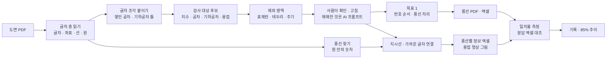

# 검사 기준서 작성 자동화 — 프로젝트 기획서

| 항목 | 내용 |
|---|---|
| 리포 | data10-03 |
| 제출자 | 황수용 |
| 직무·소속 | 품질경영팀 (회사명 생략) |
| 과정 | 현장 데이터 디지털화 전문가과정 2차수 |
| 작성일 | 2026-10-20 (v0.1) · 2026-10-21 (v0.2 · v0.3) |
| 문서 상태 | v0.3 — 3차 회신(「2x」 뜻 · 다른 도면 2종과 사람이 쓴 전체 기준서 · 한 줄 선 글꼴도 검사 대상) 반영, 11.6 3차 반영 절 신설 |

---

## 1. 추진 배경과 현안

- 품질경영팀은 도면을 보고 검사 기준서를 만듭니다. 도면의 검사 대상 표기(치수 · 공차 · 기하공차 · 용접)마다 번호 풍선을 달고, 풍선 번호별로 Spec 과 공차를 엑셀에 옮겨 적는 일입니다.
- 이 일을 자동화하는 프로젝트가 이미 어느 정도 진행되어 있지만, **정확도 · 인식 일치율이 낮아 최소 85% 까지 올리고 싶다**는 것이 제출 원문의 핵심입니다.
- 일치율은 지금 **두 가지 식**으로 셉니다(수강생 회신, 10장 ②): 필드 일치율 = 그 필드의 일치 건수 ÷ 비교 대상 건수 × 100, 완전 일치율 = 항목명 · 기준값 · 공차가 모두 일치한 행 ÷ 비교 대상 행 × 100. 도구도 같은 식으로 셉니다(11장).
- 도면은 벡터 PDF 입니다(10장 ④). 다만 받은 도면은 **도면 쪽에 글자 층이 없고, 글자가 칠한 윤곽선(도형)으로 들어 있었습니다** — 글자를 고를 수 없는 벡터 PDF 라 1차 도구는 치수를 하나도 읽지 못했습니다(11장).
- 기준서는 **치수 기준서와 용접 기준서 두 가지**로 나뉘고, 한 도면에 둘이 같이 있을 수도, 따로 있을 수도 있습니다.
- 자주 틀리는 것은 ① 모든 용접 기호와 각장 Spec, ② 부기(주기 · 노트)입니다(10장 ③).

## 2. 목표

### 2.1 최종 목표

- **목표 1 · 번호 풍선 자동 배치** — 풍선이 없는 PDF 도면에서 검사 대상 표기를 인식해 그 자리에 번호 풍선을 달고, 풍선이 들어간 PDF 도면을 내보냅니다.
- **목표 2 · 풍선별 정보 엑셀 추출** — 풍선이 이미 있는 PDF 도면에서 풍선마다 가리키는 치수 · 공차 · 용접 정보를 연결해 엑셀로 냅니다. Spec 없이 형상만 있는 용접은 그 형상 그림을 남깁니다.
- **인식 일치율 85% 이상** — 사람이 만든 정답과 대조한 숫자로 확인합니다.

### 2.2 1차 개발 목표

실제 도면과 정답을 받기 전이라, 1차는 **「정답 대조 · 일치율 측정」을 중심에 둔 브라우저 도구**를 만듭니다.

- 벡터 PDF 를 열어 글자(좌표 포함) · 선 · 원을 읽고, 규칙으로 검사 대상 후보를 찾습니다. 사람이 고치고 더할 수 있습니다.
- 목표 1(풍선 자동 배치 → 풍선 PDF · 엑셀)과 목표 2(풍선 읽기 → 엑셀)를 규칙으로 만듭니다.
- 정답 엑셀을 올리면 정밀도 · 재현율 · F1 · 값 일치율을 구분별로 보여 주고, 놓친 것 · 값이 다른 것 · 더 찾은 것을 목록으로 냅니다. 측정할 때마다 기록해 85% 까지의 추이를 봅니다.
- 가상 도면 3종(풍선 없음 · 풍선 있음 · 정답 엑셀 한 벌씩)을 직접 만들어 흐름 전체를 검증합니다.

### 2.3 2차 개발 목표 (2026-10-21, 수강생 회신 반영)

- 받은 실제 도면 2장으로 **수강생 방식의 일치율(필드 · 완전)** 을 재고, 틀리는 유형별로 규칙을 고쳐 다시 잽니다(개선 전 · 후 숫자를 남김).
- 글자 층이 없는 윤곽선 글자 도면을 읽고, 자주 틀리는 용접 기호 · 각장 · 부기를 따로 다룹니다.
- **치수 기준서 / 용접 기준서를 나눠** 풍선 · 엑셀을 따로 냅니다.
- 이번 틀림 유형을 흉내 낸 가상 도면(도면 D)과 테스트를 더해, 같은 틀림이 다시 생기면 테스트가 잡게 합니다.

### 2.4 3차 개발 목표 (2026-10-21, 3차 회신 반영)

- **처음 보는 도면 2종으로 먼저 잽니다** — 2차 규칙을 그대로 둔 채 잰 숫자가 「새 도면에서의 실력」 입니다(고치기 전 숫자를 따로 남김).
- 엑셀을 **수강생 기준서와 같은 칸 · 순서**로 냅니다(No. · Inspection Item · Standard · Tolerance MAX/MIN · Inspection Equipment). 「2x」 는 같은 Spec 을 두 곳 잰다는 뜻이라 측정값 칸을 2개 비워 둡니다.
- 회색 · 파란 **한 줄 선 글꼴**(치수 · 각장 · 각목 · 부기)도 읽습니다. 크기 글자 없는 특수 용접 기호 묶기를 보완합니다.
- 새 도면에만 맞춘 규칙이 되지 않도록, 고친 규칙마다 가상 도면 E 와 테스트로 「일부러 끄면 실패하는지」 확인합니다.

## 3. 보유 데이터

| 데이터 | 형태 | 규모·주기 | 비고(민감도 등) |
|---|---|---|---|
| 도면 PDF | 벡터 PDF(A0, 여러 쪽) — 도면 쪽은 글자가 칠한 윤곽선, 부품표 · 보고서 쪽만 글자 층 | 2장 받음(2026-10-21) | 회사 도면 — 리포 · 커밋 · 패들릿에 넣지 않음. 측정은 작업 컴퓨터 임시 폴더에서만 하고 지움. 도구는 브라우저 안에서만 읽음 |
| 정답(사람이 풍선 단 PDF) | 풍선 PDF — 같은 도면의 치수 기준서용 · 용접 기준서용 각 1부 | 2장 × 2 = 4부, 풍선 537개(치수 307 · 용접 230) | 풍선 도구가 단 색 원 + 글자 층 번호 + 빨간 지시선. 추출 엑셀(정답 표)은 아직 받지 않음 (10장 ⑧) |
| 지금 쓰는 일치율 식 | 필드 일치율 · 완전 일치율 | — | 받음(10장 ②). 도구 측정 화면에 같은 식으로 넣음 |
| 검사 기준서 양식 | Excel 로 가정 | — | 엑셀 출력 칸 배치를 맞추기 위함 (10장 추가 ⑤) |

1단계는 직접 만든 가상 도면으로 만들었고, 2차에서 받은 실제 도면 2장으로 일치율을 쟀습니다(11장). 리포의 예시는 여전히 가상 도면뿐입니다.

## 4. 해결 방안 개요

## 5. 주요 기능

| 기능 | 설명 | 우선순위 |
|---|---|---|
| PDF 열기 · 글자 층 읽기 | 브라우저 안에서 pdf.js 로 쪽 그림, 글자(좌표 · 각도 · 크기), 선 · 원 · 작은 삼각형을 읽음 | MVP |
| 윤곽선 글자 읽기(2차) | 글자 층이 없으면 칠한 윤곽선을 참조 글자(Liberation Sans · DejaVu Sans)와 모양으로 맞춰 되읽음. 0° · ±90° · 180° · 비스듬한 글, 띄어쓰기, 선으로 그린 Ø · × · ° · 기하공차 기호 | MVP(2차) |
| 용접 기준선 · 기준서 구분(2차) | ISO 2553 기준선 + 점선, 기호 쪽마다 크기 글자 · 형상, 단속(개수x길이), 용접 부기. 치수 기준서 / 용접 기준서로 나눠 번호 · 풍선 · 엑셀 | MVP(2차) |
| 검사 대상 후보 인식 | 치수(길이 · Ø · R · C · M 나사 · 각도), ± · 위아래로 쌓인 공차, 끼워맞춤(H7 · g6 등 ISO 286 환산), 기하공차 틀, 용접(삼각형 옆 크기 · a · z · C.W · 단속), 표면 거칠기 | MVP |
| 제외 영역 | 테두리 구역 번호 · 표제란 · 개정란 · 주기 문장 자동 제외 + 사람이 끌어서 그리는 제외 영역 | MVP |
| 후보 고치기 | 도면 위 네모를 눌러 구분 · 값 고치기, 글자 눌러 추가, 형상 영역 그리기, 빼기 · 되살리기 | MVP |
| 목표 1 풍선 배치 | 줄 · 열 · 구역 순서로 번호, 글자 · 풍선 · 선과 겹치지 않는 자리, 끌어서 옮기기, 번호 바꾸기 → 풍선 PDF · PNG · 엑셀 | MVP |
| 목표 2 풍선 읽기 | 원 안의 숫자를 풍선으로 읽고 지시선 끝 또는 가까운 글자에 연결(서로 가로채지 않게), 글자 없는 용접은 형상 그림 · 좌표 | MVP |
| 일치율 측정 | 정답 엑셀 대조 → **필드 일치율(항목명 · 기준값 · 공차) · 완전 일치율(수강생 식)** · 정밀도 · 재현율 · F1 · 값 일치율 · 구분별 · 틀린 목록, 측정 기록과 추이 | MVP (중심) |
| AI 판단 보조 | 「확인 필요」 후보를 주변 글자와 함께 묻는 프롬프트(복사 · 붙여 넣기), 답 표 읽어 반영. 선택: OpenAI 호환 서버 자동 보내기 | MVP(선택) |
| 스캔 도면 · 한 줄 선 글꼴 | 그림 도면, 한 줄 선(스트로크)으로 쓴 글꼴 읽기 | 확장(다음 단계) |
| 원본 벡터 유지 PDF 편집 | 원본 PDF 에 풍선만 덧그리기 | 확장(2단계) |

## 6. 기대 산출물

1. **도면 인식 · 풍선 도구(브라우저)** — 후보 인식, 목표 1 풍선 PDF, 목표 2 풍선별 엑셀
2. **풍선별 정보 엑셀** — 번호 · 쪽 · 구역 · 구분 · 종류 · 원문 · 공칭값 · 상한/하한 공차 · 최대/최소 허용값 · 단위 · 수량 · 데이텀 · 좌표 · 확인 필요 · 용접 형상을 잘라낼 영역 · 기준서(2차: 치수 기준서 · 용접 기준서 시트를 나눔)
3. **일치율 측정 화면과 기록** — 정답 대조 결과, 구분별 일치율, 틀린 항목 엑셀
4. **가상 도면 4종과 정답** — 규칙 검증 · 시연용(도면 D 는 2차에서 실제 도면의 틀림 유형을 흉내 내 더함)
5. **스캔 도면 처리 · 원본 유지 PDF** — 2단계

## 7. 기술 구성

| 과정 도구 | 이 프로젝트에서 쓰는 곳 |
|---|---|
| 암묵지 자산화·전략기획 | 「검사 대상」 판단 기준(무엇에 풍선을 다는가 · 참고 치수 · 일반공차 · 주기), 번호 매기는 순서, 용접 표기 관행을 꺼내 적기 |
| 코랩(Python)·바이브코딩 | 가상 도면 생성(reportlab), 인식 규칙 · 일치율 측정 · 브라우저 도구 제작 — 1단계의 중심 |
| 생성형 AI | 규칙이 애매하다고 본 후보만 주변 글자와 함께 물어보기(반자동). 도면 그림 전체를 AI 에 보내는 방식은 보안 확인 후 2단계 |
| RAG·자동화 | 회사 검사 기준서 · 과거 풍선 도면을 근거로 한 판단, 여러 도면 일괄 처리 (확장) |

**개발 형태(권장)**

- 1단계는 **설치 없이 브라우저에서 도는 정적 웹 도구**입니다. 도면 PDF 를 브라우저 안에서만 읽고 계산하므로 도면이 밖으로 나가지 않습니다. 인식 · 배치 · 연결 · 측정은 AI 없이 동작합니다.
- **벡터 PDF 전제**: CAD 에서 내보낸 PDF 는 글자가 글자(좌표 · 크기 · 각도)로 들어 있어 규칙으로 정확히 읽을 수 있습니다. 글자를 칠한 윤곽선으로 바꾼 PDF 는 2차부터 모양으로 되읽습니다(OCR 없이, 벡터 도형 그대로). 스캔 그림과 한 줄 선 글꼴은 아직 OCR 등 다른 방법이 필요합니다.
- **측정이 먼저**: 같은 도면 · 같은 정답으로 다시 재면 규칙을 고친 효과가 숫자로 보입니다. 명령줄(`node scripts/measure-samples.mjs 도면.pdf 정답.xlsx`)로도 같은 측정을 돌릴 수 있습니다.

## 8. 개발 단계

### 1단계 — 지금 개발 가능한 부분

실제 도면이 없어도 **벡터 PDF 의 구조(글자 층 · 선 · 원)와 도면 관행만으로** 흐름 전체를 만들 수 있습니다. 가상 도면으로 먼저 만들고, 실제 도면을 받으면 같은 측정 화면에서 일치율을 재고 규칙을 맞춥니다.

- PDF 열기(여러 쪽) · 쪽 그림 · 글자 조각과 좌표 · 선 · 원 · 작은 삼각형 읽기, 글자 층 없음(스캔) 알림
- 글자 조각 붙이기: 따로 쓴 「45」 「±0.1」, 위 · 아래로 쌓인 작은 공차, 칸이 떨어진 기하공차 틀, 90° 돌린 치수
- 후보 분류 규칙(치수 · 공차 · 기하공차 · 용접 · 기타), ISO 286 끼워맞춤 일부 등급 환산, 「확인 필요」 표시
- 제외: 테두리 구역 번호 · 표제란 · 개정란(낱말 설정) · 주기 문장 · 참고 치수 · 날짜 · 척도, 사람이 그리는 제외 영역
- 용접: 직각 이등변 삼각형(필릿 기호)과 옆 글자를 한 항목으로, 글자 없는 삼각형은 「용접 형상」 + 잘라낼 영역
- 목표 1: 번호 순서(줄 · 열 · 구역) · 겹침 피하기 · 끌어 옮기기 · 번호 바꾸기 → 풍선 PDF(쪽 그림 + 보이지 않는 글자 층 + 벡터 풍선) · PNG · 엑셀
- 목표 2: 원 안 숫자 = 풍선, 지시선(꺾인 것 포함) 끝 · 가까운 글자 연결(최대 짝짓기), 연결 바꾸기 · 비우기 → 엑셀 · 형상 그림
- 일치율 측정: 정답 엑셀(열 이름 자동 인식, 원문만 있어도 됨) → 정밀도 · 재현율 · F1 · 값 일치율 · 구분별 · 틀린 목록 · 기록 · 추이, 명령줄 측정 스크립트
- 애매한 후보 AI 프롬프트(반자동), JSON 백업
- 가상 도면에는 일부러 함정(표제란 숫자 · 구역 번호 · 일반공차 · 주기 속 숫자 · 참고 치수 · 화살촉 삼각형)과, 1단계로는 못 읽는 「선으로 그린 치수」 하나를 넣어 규칙이 제대로 걸러 내는지 · 한계가 숫자로 드러나는지 확인합니다.

### 2단계

- 실제 도면 2~3장과 정답으로 일치율 측정 → 틀리는 유형별로 규칙 보정(표제란 낱말 · 회사 풍선 모양 · 용접 표기 관행) — **2차(2026-10-21)에 2장으로 진행, 11장**
- 다른 도면 몇 장으로 다시 재기(같은 2장에 맞춘 규칙이 새 도면에도 맞는지), 수강생 정답 엑셀과 필드 정의 맞추기
- 스캔 도면 · 글자를 선으로 바꾼 PDF: OCR(브라우저 Tesseract 또는 사내 허용 OCR)로 글자 층 만들기
- 원본 PDF 벡터를 그대로 두고 풍선만 덧그리는 PDF 편집(라이브러리 도입)
- 회사 검사 기준서 양식에 맞춘 엑셀 출력, 지금 쓰시는 방식(10장 ②)과 같은 도면으로 나란히 비교

### 3단계

- 사내 허용 AI(비전 모델 포함)로 애매한 표기 판단 자동화, 판단 근거를 측정 기록에 남기기
- 여러 도면 일괄 처리 · 공유 DB(팀이 같은 정답 · 기록을 보기)

## 9. 기대 효과

- **현재 수준을 숫자로** — 정답 대조로 지금 일치율과 구분별 약점(치수 · 공차 · 용접 중 어디가 틀리는지)이 보입니다.
- **개선 효과 확인** — 규칙을 고칠 때마다 같은 도면으로 다시 재서 85% 까지 얼마나 남았는지 기록합니다.
- **풍선 · 옮겨 적기 시간 단축** — 후보 인식과 풍선 배치, 풍선별 엑셀이 자동으로 나오고, 사람은 「확인 필요」 표시된 것만 봅니다.
- **도면 보안** — 도면이 브라우저 밖으로 나가지 않습니다.

수강생이 지금 쓰는 방식의 일치율 수치는 아직 받지 않았습니다. 실제 도면 2장으로 잰 도구의 숫자는 11장에 있습니다 — 같은 2장으로 규칙을 고치고 같은 2장으로 잰 것이라 새 도면에서는 낮을 수 있습니다. 작업 시간 수치는 없어 적지 않습니다.

## 10. 수강생 확인 목록

패들릿 댓글로 요청드린 것입니다. ①~④ 는 2026-10-21 회신을 받아 2차에, ⑧~⑩ 은 같은 날 3차 회신을 받아 3차에 반영했습니다(11장).

1. 풍선 없는 도면 PDF 2~3장과, 같은 도면의 정답 — **받음**: 도면 2장(원도) + 같은 도면의 치수 기준서용 · 용접 기준서용 풍선 PDF. 추출 엑셀(정답 표)은 아직 없어, 풍선 PDF 에서 풍선 번호 · 지시선 끝을 자동으로 뽑고 값은 사람이 읽어 정답표를 만들었습니다.
2. 지금 쓰는 방식과 일치율을 센 방법 — **받음**: 필드 일치율 · 완전 일치율. 도구에 같은 식으로 넣었습니다. 지금 방식으로 잰 수치(몇 %)는 아직 없습니다.
3. 자주 틀리는 사례 — **받음**: 모든 용접 기호 및 각장 Spec, 부기(주기 · 노트).
4. 도면 PDF 가 벡터인지 스캔 그림인지 — **받음**: 벡터. 단, 도면 쪽 글자는 칠한 윤곽선이었습니다.

3차 회신(2026-10-21)으로 받은 것:

8. **검사 기준서 엑셀** — **받음**: 다른 도면 2종의 사람이 작성한 전체 기준서(치수 시트 · 각장 시트). 칸은 No. · Inspection Item(영어 낱말 — Dimension · Hole · Flatness … · Weld, 부기는 그 문장) · Standard · Tolerance(MAX · MIN) · Inspection Equipment. 「2x」 는 같은 Spec 을 두 곳 잰다는 뜻(실측값 2개). 엑셀 양식을 이 칸에 맞췄습니다(11.6).
9. **다른 도면** — **받음**: 다른 시료 도면 2종(원도 + 치수용 · 용접용 풍선 PDF). 2차 도구로 먼저 재고(처음 보는 도면), 고친 뒤 다시 쟀습니다(11.6).
10. **한 줄 선 글꼴** — **받음**: 회색 · 일부 파란 글도 치수 · 각장 · 각목 · 부기면 검사 대상. 선 글꼴 읽기를 더했습니다(11.6).

다시 확인하고 싶은 것(4차용):

11. 이번 기준서의 몇 칸이 도면 글과 다릅니다 — 치수 63번 · 400번은 도면에 적힌 공차와 기준서 공차가 다르고, 305번은 공차 없는 치수인데 기준서 공차가 일반공차(ISO 13920-BF) 표 값과 다릅니다. 어느 쪽이 맞는지 알려 주시면 정답을 고칩니다.
12. 「No Weld」 처럼 용접하지 않는 구간의 길이(용접 152 · 153번)는 도면에서 어떻게 알아보는지(도면 글만으로는 「Dimension」 과 구분이 안 됨), 치수 448번처럼 PCD 인지 구멍인지 글만으로 갈리지 않는 지름은 어떻게 정하는지.
13. 「2x」 를 엑셀에서 측정값 칸 2개(한 행)로 둘지, 같은 번호 2행으로 나눌지 — 지금은 한 행에 측정값 칸을 개수만큼 비워 둡니다.

추가로 확인하고 싶은 것(답을 받으면 반영):

5. 번호 매기는 규칙(위→아래? 시계 방향? 구역 순?) — 받은 풍선 PDF 는 두 도면을 이어서 번호를 매겼습니다(치수 1~307, 용접 1~230). 도구는 기준서마다 1번부터 매기고, 시작 번호는 설정에서 바꿉니다.
6. 풍선에 넣는 것 · 빼는 것의 기준 — 참고 치수 · 일반공차 적용 치수 · 표면 거칠기 · 주기 지시도 풍선을 다는지(목표 1 의 정밀도 70~78% 는 사람이 풍선을 달지 않은 치수까지 잡은 것)
7. 외부 AI(ChatGPT 등) 사용 허용 여부, 사내 허용 AI 가 있는지

## 11. 2차 반영 내역 (2026-10-21)

### 11.1 받은 것

| 회신 | 내용 | 반영 |
|---|---|---|
| ① 도면 · 정답 | 풍선 없는 원도 2장(A0) + 같은 도면의 치수 기준서용 · 용접 기준서용 풍선 PDF | 실제 도면 측정(11.3). 회사 도면이라 리포 · 커밋 · 패들릿에 넣지 않고, 작업 컴퓨터의 임시 폴더에서만 재고 지움 |
| ② 일치율 식 | 필드 일치율 = 해당 필드의 일치 건수 ÷ 비교 대상 건수 × 100, 완전 일치율 = 항목명 · 기준값 · 공차가 모두 일치한 행 ÷ 비교 대상 행 × 100 | 측정 화면 · 대조 결과 엑셀 · 명령줄에 같은 식으로 넣음(11.2) |
| ③ 자주 틀림 | 모든 용접 기호 및 각장 Spec, 부기(주기 · 노트) | 용접 기준선 규칙 · 용접 부기(11.4) |
| ④ 도면 형식 | 벡터 PDF. 치수 기준서와 용접 기준서 2가지, 한 도면에 같이 또는 따로 | 윤곽선 글자 읽기 · 기준서 구분(11.4) |

### 11.2 일치율을 세는 방법(도구 안)

- **비교 대상 = 정답 행.** 도구가 못 찾은 정답 행은 세 필드 모두 불일치로 셉니다(목표 2 는 풍선 번호로, 목표 1 은 값으로 짝을 지음).
- 세 필드의 뜻(수강생 정답 엑셀을 받으면 맞춤 — 10장 ⑧):

| 필드 | 치수 · 공차 | 기하공차 | 용접 크기(a · z) | 용접 단속 | 용접 부기 | 용접 형상 |
|---|---|---|---|---|---|---|
| 항목명 | 종류(길이 · 지름 · 반지름 · 각도 · 모따기 · 나사 · 표면 거칠기) | 평면도 · 평행도 · 직각도 · 위치도 · 동심도 … | 목두께 · 각장 · 용접 크기 | 단속 | 부기 | 용접 형상 |
| 기준값 | 공칭값 | 공차값 | 크기 | 개수x길이(예: 4x40) | 문장(띄어쓰기 · 기호 무시, 닮음 80% 이상) | 없음 |
| 공차 | 상한 / 하한 | 데이텀 | 없음 | 없음 | 없음 | 없음 |

### 11.3 실제 도면 2장 측정 — 개선 전 · 후

정답 537개(치수 307 · 용접 230). 1차 도구 = 2026-10-20 커밋, 2차 도구 = 이번 커밋. 같은 도면 · 같은 정답 · 같은 계산.

| 목표 2 — 풍선 PDF → 풍선별 정보 | 1차 · 완전 일치율 | 2차 · 완전 일치율 | 2차 · 필드(항목명 / 기준값 / 공차) |
|---|---|---|---|
| 치수 기준서 307 | 0.0% | **91.5%** | 92.8 / 93.2 / 92.5% |
| 용접 기준서 230 | 7.0% | **89.1%** | 89.1 / 89.1 / 90.9% |
| 합계 537 | 3.0% | **90.5%** | 91.2 / 91.4 / 91.8% |

| 목표 1 — 원도 → 후보(값으로 짝) | 1차 · 완전 일치율 / 정밀도 | 2차 · 완전 일치율 / 정밀도 |
|---|---|---|
| 치수 | 6.5% / 18.9% | **88.6% / 70.3%** |
| 용접 | 12.2% / 6.6% | **93.5% / 78.0%** |

- 1차가 거의 0% 인 까닭은 도면 쪽에 글자 층이 없었기 때문입니다(치수를 하나도 못 읽음). 용접 7% 는 작은 삼각형을 「용접 형상」 으로 잘못 잡은 것이 우연히 맞은 것입니다.
- **85% 목표: 이 2장에서는 목표 2 · 목표 1 모두 넘었습니다. 다만 같은 2장을 보며 규칙을 고치고 같은 2장으로 잰 숫자라, 새 도면에서는 낮게 나올 수 있습니다(10장 ⑨).**
- 정답표 만들기: 풍선 PDF 의 풍선(색 원 + 글자 층 번호 + 빨간 지시선)에서 번호 · 중심 · 지시선 끝을 자동으로 뽑았습니다(537개 모두, 빠짐 0). 가리키는 표기의 값은 대상 글자도 윤곽선이라 자동 추출이 되지 않아, 지시선 끝 둘레를 잘라 사람이 읽어 적었습니다. 도구 결과와 다른 곳을 다시 크게 보고 정답표의 읽기 실수 2건을 고쳤습니다.

### 11.4 실제 도면에서 드러난 틀림과 고친 것

| 틀림 유형 | 고친 것 | 다시 생기면 잡는 테스트 |
|---|---|---|
| 도면 쪽 글자가 칠한 윤곽선(글자 층 없음) | 윤곽선 글자 읽기 — 바깥 윤곽 + 구멍 = 글자, 16×16 격자 모양 맞추기, 방향(0° · ±90° · 180° · 비스듬히) 점수, 띄어쓰기(좁은 「1」 · 넓은 자간), 숫자 사이 O → 0 · 기준선 아래 작은 점 → 쉼표, 뒤집어도 같은 한두 글자는 옆 글 방향 | 도면 D 되읽기 · 쉼표 |
| Ø · × · ° · 기하공차 기호가 선 | 원 + 비스듬한 선 = Ø, 대각선 둘 = ×, 작은 고리 = °, ⌖ ◎ ▱ ∥ ⊥ 는 틀 칸 안 + 칸 글자가 있을 때만 | 선 기호 · 빗금 · 빈 네모 |
| 같은 크기로 쌓인 공차 · 떨어진 「±1」 · 「6x」+「M12」 · 「PCD」+「Ø120」 | 같은 크기 두 줄 공차 붙이기, 앞뒤 조각 잇기 | 쌓인 공차 · 잇기 |
| ① 용접 기호 · 각장 | ISO 2553 기준선(실선 + 점선), 기호 쪽마다 크기 글자 또는 「용접 형상」, 기준선 위 숫자 = 용접 크기, 개수x길이 = 단속. 칠한 삼각형 규칙은 기준선이 있는 도면에서는 쓰지 않음 | 용접 기준선 |
| ② 부기 | 기준선 아래 · 위 문장 묶음 = 「용접 부기」 | 용접 기준선 |
| 기준서 2분류 | 치수 / 용접 기준서마다 1번부터 번호 · 풍선 PDF · 엑셀(전체면 시트 둘), 풍선 읽기는 그 기준서 항목에만 연결 | 기준서 구분 |
| 큰 풍선이 도면 선 위에 놓여 지시선을 도면 선으로 잡음 | 지시선은 원 둘레에서 반지름 방향, 색 있는 선 먼저 | 빨간 두 토막 지시선 |
| 도면의 원래 품번 풍선(윤곽선 숫자)이 검사 풍선과 섞임 | 글자 층 풍선과 섞이면 글자 층 풍선만, 원 안 숫자는 옆 글자와 붙이지 않음 | 품번 풍선 12 · 풍선 PDF 되읽기 |
| A0 에서 테두리 띠(짧은 변 4% = 33mm)가 안쪽 용접 글자를 먹음 | 띠 폭 상한 12mm(설정) | A0 테두리 |
| 부품표 · 보고서 쪽, 「02」 같은 표식 번호가 후보 | 원 · 곡선이 없고 낱말이 35% 이상인 쪽 빼기(설정), 앞자리 0 정수는 치수 아님 | 부품표 · 보고서 쪽 |

테스트는 35개입니다(1차 25 + 2차 10). 2차 규칙마다 일부러 끄거나 바꿔서 해당 테스트가 실패하는 것을 확인했습니다.

### 11.5 남은 한계(목표 2 에서 틀린 약 50개)

- **한 줄 선으로 쓴 글꼴(회색 · 일부 파란 글, 약 15개)** — 칠한 윤곽선이 아니라 선이라 지금 방법으로 못 읽습니다(10장 ⑩).
- **크기 글자 없는 특수 용접 기호** — 플레어 · 플러그(네모) · 둥근 마감 기호 일부를 기준선과 못 묶거나 기준선을 못 찾음(약 11개).
- 기준선에서 먼 부기 문장, 기하공차 틀 두 줄의 윗줄 · 아랫줄이 바뀐 연결, 아주 작은 숫자 「5」 몇 개.
- 윤곽선 읽기는 산세리프 글꼴 기준이라, 다른 CAD 글꼴이면 참조 글자표를 더해야 합니다. A0 한 쪽에 몇 초 걸립니다.

### 11.6 3차 반영 (2026-10-21, 새 도면 2종 · 사람이 쓴 전체 기준서)

**받은 것** — 다른 시료의 도면 2종(A0, 원도 + 치수용 · 용접용 풍선 PDF)과 사람이 작성한 전체 기준서 엑셀(치수 시트 454행 · 각장 시트 362행). 회사 도면이라 리포 · 커밋 · 패들릿에 넣지 않고 작업 컴퓨터의 임시 폴더에서만 재고 지웠습니다(도면번호 · 품명 · 모델명도 적지 않음).
정답은 이번에는 **사람이 쓴 기준서 그대로**입니다(풍선 PDF 의 풍선 번호 = 기준서 No., 치수 454 · 용접 362 모두 짝이 맞음). 2차처럼 값을 우리가 읽어 적지 않았습니다.

**세는 법** — 수강생 식 그대로, 기준서 칸으로 셉니다. 항목명 = Inspection Item 이 같은가(부기는 문장 닮음 80% 이상), 기준값 = Standard 가 같은가(띄어쓰기 · 「4,6」/「4.6」 · 「07」/「7」 · 「2.0」/「2」 는 같게), 공차 = MAX · MIN 이 둘 다 같은가. 비교 대상 = 정답 행, 못 찾은 행은 불일치.
「고치기 전」 은 2차 도구(be5a0ad)가 읽은 결과를 같은 기준서 칸으로 옮겨 잰 것입니다(칸 옮기기만 새로 했고, 일반공차는 2차 도구에 없어 쓰지 않음).

| 목표 2 — 풍선 PDF → 풍선별 정보 | 고치기 전(처음 보는 도면) · 완전 | 고친 후 · 완전 | 고친 후 · 필드(항목명 / 기준값 / 공차) |
|---|---|---|---|
| 치수 기준서 454 | 9.0% | **97.8%** | 99.3 / 98.9 / 98.9% |
| 용접 기준서 362 | 91.2% | **96.4%** | 96.4 / 96.4 / 96.4% |
| 합계 816 | 45.5% | **97.2%** | 98.0 / 97.8 / 97.8% |

| 목표 1 — 원도 → 후보(값으로 짝) | 고치기 전 · 완전 / 정밀도 | 고친 후 · 완전 / 정밀도 |
|---|---|---|
| 치수 | 9.0% / 6.7% | **98.9% / 85.4%** |
| 용접 | 97.0% / 71.9% | **99.2% / 91.3%** |

- **처음 보는 도면에서 2차 도구의 치수는 9.0% 였습니다.** 이번 도면은 2차 도면과 달리 글자 층이 있었는데, CAD 가 자간을 넓혀 「4 6 2」 「2 7 , 5」 「± 1」 꼴(예시 값)로 글자 사이에 빈칸을 넣어 숫자가 한 자씩 쪼개졌습니다. 용접은 「a2,8」 처럼 빈칸 없이 써서 91.2% 였습니다. 2차의 90.5% 는 같은 2장으로 고치고 잰 숫자였다는 것이 그대로 드러났습니다.
- **고친 후 숫자도 이 2종을 보며 고치고 이 2종으로 잰 것입니다.** 다음 도면에서는 다시 낮게 나올 수 있어, 새 도면을 받으면 이번처럼 먼저 재는 순서를 지킵니다. 과적합을 줄이려고 도면 2종에만 맞춘 낱말 · 좌표 규칙은 넣지 않았고, 고친 규칙마다 가상 도면 E · 테스트를 더해 일부러 끄면 실패하는 것을 확인했습니다.
- 목표 1 의 「값으로 짝」 은 같은 값이 여러 번 나오면 느슨하게 짝이 지어져 높게 나옵니다(예: 같은 a 크기가 80개 넘게 되풀이). 목표 2(번호로 짝)가 더 엄격한 숫자입니다.

**고친 것(일반 규칙)**

| 고친 것 | 새 도면에서 본 것 |
|---|---|
| 자간 넓힌 글자 층 — 한 글자씩 빈칸으로 띄운 글은 빈칸을 뺌(「4 6 2」 → 462, 「± 1」 → ±1 — 예시 값) | 치수 대부분이 숫자 하나씩 쪼개짐 |
| 일반공차 — 도면 주기의 「ISO 13920-BF」 · 「ISO 2768-m」 을 찾아 공차 없는 치수의 Tolerance 칸을 표로 채움(13920 B: 30 이하 ±1 · 30~400 ±2 · 400~1000 ±3 · 1000~2000 ±4, 각도 ±0.75°), 2mm 미만 · 0 은 비움. 설정에서 고르거나 끔 | 기준서의 공차 칸 대부분이 일반공차 |
| 기준서 양식 엑셀 — 첫 시트를 No. · Inspection Item · Standard · Tolerance MAX/MIN · Inspection Equipment · 개수 · 측정값으로. 항목명은 영어 낱말(Ø = Hole, 「PCD」 = PCD, 나사 = TAP 은 보통 나사 피치를 붙여 M20x2.5 — 예시), 기하공차 · 표면 거칠기는 기준값 = 공차값 · MAX 0 · MIN -값, 용접 목두께는 「a4.6 (07x07)」(각장 = a × √2 반올림), 단속은 「3x25」(각도 표기 뺌), 양쪽 각장 「z6 z8」(모두 예시 값), 형상만 있는 용접은 Weld · Visual, 부기는 항목명 = 문장. 「… 상세」 시트에 도구가 읽은 모든 칸 | 회신 ⑧ |
| 「2x」 — 개수만 있는 글을 가장 가까운 항목의 개수로 붙이고, 기준서 엑셀에 측정값 칸을 개수만큼 비워 둠(그 뒤 칸은 「-」). 「M20 x28」(예시) 의 28 은 피치가 아니라 깊이로 봄 | 회신 ① |
| 정답 읽기 — 수강생 기준서(쪽마다 머리행이 되풀이 · Tolerance 아래 MAX/MIN · 시트별 치수/각장)를 그대로 정답으로 읽고, 치수 · 용접 번호가 겹치면 기준서 + 번호로 짝 | 사람이 쓴 기준서를 그대로 정답으로 |
| 한 줄 선 글꼴 — 작은 선 토막을 글자로 묶어 펜 두께로 칠해 직접 그린 선 글자표(숫자 · 대문자 · a · x · z · ± · Ø, CAD 의 팔각형 0/O 꼴 포함)와 모양 맞추기. 글자 층 글 바로 앞의 선 글자(「M」+「20」 · 「Φ」+「71」 꼴)는 붙이고, 같은 크기 선 글자가 한 줄로 둘 이상이면 새 글로(치수 · 각장 · 부기). 빗금 · 평행선 · 되풀이 「XXX」 는 글로 만들지 않음 | 회신 ③ — 새 도면에서는 「M」 · 「Φ」 가 선 글꼴 |
| 선 기호 — 글자 층 도면에서도 Ø · ° · 기하공차 기호를 찾고, 점이 많은 꺾은선 원(Φ · ◎), 두 토막으로 그은 「⊥」, 틀 칸 한가운데 짧은 가로선 = ⏤ 진직도. 기하공차 기호는 칸 글자도 틀 칸 안이고 두 칸이 한 변을 함께 쓸 때만(구멍 중심 표시 옆 치수를 위치도로 잡던 것) | 기하공차 30여 개가 「Dimension」 으로 |
| 용접 기호 묶기 — 플러그 · 슬롯처럼 떨어진 두 세로선, J · 플레어처럼 선 하나에 호가 붙은 기호도 「기호」 로. 대신 기준선은 한쪽 끝에 화살표 · 꼬리가 비스듬히 붙은 선만(숨은선이 붙은 외형선을 기준선으로 보던 것) | 크기 없는 특수 용접 기호 |
| 용접 크기 숫자 — 기준선과 같은 방향 · 기준선 위쪽 구간의 숫자만(세로 치수 · 기준선 왼쪽 치수를 용접 크기로 보던 것), 꺾은선 원 안 숫자(품번)는 후보에서 뺌 | 치수가 용접으로 빠짐 |
| 풍선 연결 — 전체 (풍선, 후보) 쌍을 거리 순으로 먼저 짝짓고 남은 풍선만 비켜 주기, 색 있는 짧은 지시선(가운데서 나뉜 첫 토막)도 지시선으로 | 이웃한 두 풍선의 연결이 서로 바뀜 |

**남은 틀림(목표 2 에서 23개)** — 용접 형상 8개(지시선이 기준선 끝 · 기호 밖을 가리키거나 기호를 못 묶음) · 용접 a 크기 연결 못 함 2개, 기준서와 도면 글이 다른 것 3개(10장 ⑪), 「No Weld」 2개 · 기준선에서 먼 부기 1개(10장 ⑫), 풍선 연결 바뀜 · 틀림 4개, 각도 표기를 기준서는 Dimension 으로 적은 것 1개, PCD/Hole 1개, 아주 작은 「8」 1개.

**테스트** — 48개(3차 13개 추가). 새 규칙마다 일부러 끄거나 바꿔서 해당 테스트가 실패하는 것을 확인했습니다(선 글꼴의 「되풀이 글자 · 곧은 선」 두 거르개는 서로 겹쳐 둘을 함께 끌 때 실패). 가상 도면 E(지어낸 값)는 위 유형을 흉내 냈고 정답은 수강생 기준서 양식입니다 — 규칙을 만든 쪽이 만든 도면이라 100% 는 실력이 아닙니다.

## 부록. 제출 원문 요약

| 출처 | 파일·게시물 | 내용 |
|---|---|---|
| 패들릿 게시물 (2차수) | 「검사 기준서 작성 자동화」 — `docs/source/패들릿_접수_원문.md` | 직무·소속(품질경영팀), 현안(목표 1 번호 풍선 자동 배치 · 목표 2 번호별 정보 엑셀 추출), 보유 데이터(도면 PDF), 기대 산출물(풍선 번호별 Spec · 공차 · 용접, 형상만 있는 용접은 도형), 일치율 85% 목표 |
| 첨부 | 없음 | 도면 · 정답 · 현재 방식은 10장 ①~④ 로 요청 |
| 패들릿 댓글 회신 (2026-10-21) | 도면 2장 · 정답 풍선 PDF · 일치율 식 · 자주 틀리는 사례 · 벡터 PDF / 기준서 2분류 — `docs/source/패들릿_접수_원문.md` | 도면 파일은 리포에 넣지 않음. 11장 |
| 패들릿 댓글 3차 회신 (2026-10-21) | 「2x」 = 실측값 2개 · 다른 도면 2종과 작성된 전체 기준서 · 회색 · 파란 글도 검사 대상 | 도면 · 기준서 파일은 리포에 넣지 않음. 11.6 |
